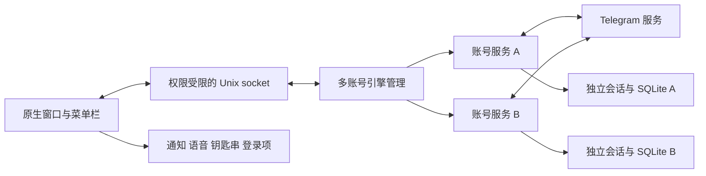

# 技术架构

SwiftUI/AppKit 负责六页窗口、菜单栏、通知、系统语音、登录项、钥匙串和子进程生命周期。Python/Telethon 引擎负责连接、同步、规则和 SQLite 单写入；两个进程通过带请求 ID、来源入口和协议版本的私有 Unix socket 通信，不监听网络语音端口。

| 源码 | 职责 |
| --- | --- |
| Sources/App.swift | 主窗口、菜单栏和退出生命周期 |
| Sources/Model.swift | 通信、来源状态、通知定位、语音队列和引擎监督 |
| Sources/Views.swift | 页面与配置交互 |
| Sources/APIConfiguration.swift | API 来源、格式和资源读取 |
| engine/accounts.py | 多账号入口、路由、独立锁、状态汇总 |
| engine/service.py | 每账号登录、事件、归档、同步和控制 |
| engine/store.py | SQLite 消息、配置、游标、提示、活动及永久去重账本 |
| engine/automation.py / reply_rule.py | 执行条件、固定匹配、网络发送和结果 |
| engine/schedule.py | IANA 时区、跨午夜、DST 和七天展开 |
| engine/backup.py / importer.py | 当前账号备份、受限恢复和旧资料导入 |

旧账号根目录不迁移，新入口使用 accounts/随机标识。配置、会话、媒体及 API 项隔离。界面查询由引擎完成，不能直接写用户数据库；不同账号命令可并行，同账号串行。

发送先插入唯一账本再联网。未知结果留 send_unknown，不重试；同编号回执更新 confirmed。固定回复 send_unverified 不等同于业务登记。消息按账号、会话、ID 保存，补录页与游标原子提交。

升级恢复需保持去重账本，未知 schema 拒绝运行。退出先阻止新发送，有限等待后关闭所有客户端和数据库。每个应用根目录使用引擎锁，禁止多个写入者同时使用相同资料。

目前没有插件框架、独立守护进程或产品云端。service.py 与 Views.swift 的功能集中，后续多规则扩展应沿现有边界拆分，不能为一次性需求增加通用编排架构。
